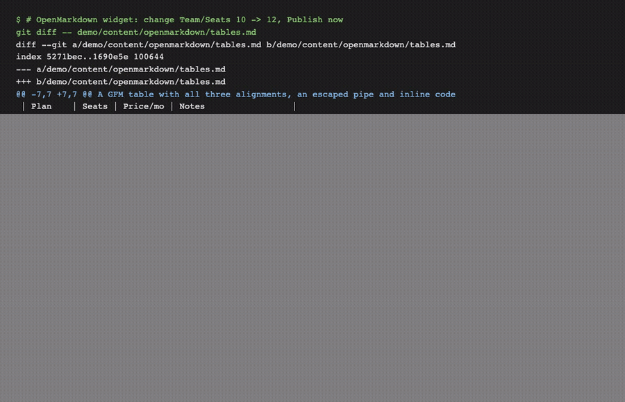

# decap-cms-widget-openmarkdown

A Markdown widget for [Decap CMS](https://decapcms.org) that edits your Markdown source directly. It renders as you type (tables, math, Mermaid, callouts), and when you change a line, the rest of the file is saved as you wrote it.

It is built on [`@openmarkdown-dev/editor`](https://www.npmjs.com/package/@openmarkdown-dev/editor), the MIT-licensed editor from [OpenMarkdown](https://openmarkdown.dev).



## Why

Decap's stock `markdown` widget parses the body into a rich-text tree and writes it back out, so editing one word can reformat other parts of the file. In our tests on four sample files, appending one word to the first line changed 6 to 17 lines with the stock widget, and 2 lines (the edited line, as − and +) with this one. Escapes, list markers, heading styles and table alignment stay as you wrote them. Related Decap issues: [#2845](https://github.com/decaporg/decap-cms/issues/2845) (tables), [#5673](https://github.com/decaporg/decap-cms/issues/5673) (added backslashes), [#2386](https://github.com/decaporg/decap-cms/issues/2386) (escaped footnotes).

| Edit (changed lines in `git diff`) | This widget | Stock `markdown` widget |
| --- | --- | --- |
| Save without touching the body | 0 | 0 |
| Append one word to the first line | 2 | 6–17 |
| Edit one table cell | 2 | 8 |
| Edit a cell so it is wider than its column | 10 (the column is re-padded) | 10 |

Tested with Decap CMS 3.17.3 and `decap-server`, driven through the Decap UI in headless Chromium. Frontmatter is serialized by Decap itself, so its YAML quoting changes the same way with either widget.

## Install

### Script tag (no build step)

Load it after `decap-cms.js`, as a module:

```html
<script src="https://unpkg.com/decap-cms@^3.0.0/dist/decap-cms.js"></script>
<script type="module" src="https://unpkg.com/decap-cms-widget-openmarkdown@0.1.0/dist/decap-cms-widget-openmarkdown.js"></script>
```

It registers itself as the widget `openmarkdown`.

### Bundler (`decap-cms-app`)

```sh
npm install decap-cms-widget-openmarkdown
```

```js
import CMS from "decap-cms-app";
import { registerOpenMarkdownWidget } from "decap-cms-widget-openmarkdown";

registerOpenMarkdownWidget(CMS);
CMS.init();
```

## Use it in `config.yml`

```yaml
fields:
  - { label: Body, name: body, widget: openmarkdown }
```

You can switch an existing collection by changing `widget: markdown` to `widget: openmarkdown`. The file format doesn't change: it is the same Markdown, so you can switch back at any time.

## What it supports

- Live preview while you type: the line with the cursor shows its Markdown source, and the rest renders.
- GFM tables, edited cell by cell inside the form. Column alignment and escaped `\|` are kept.
- Math (Temml), Mermaid diagrams, callouts, footnotes, task lists and highlighted code blocks. Diagrams and code languages load lazily.
- The preview pane uses the same renderer, in reading mode.
- Paste or drop an image: it goes through Decap's media library (`onPersistMedia`, the same path the image widget uses).
- Decap's label focus, active and inactive label styles, and `isDisabled`.

## Not yet

- No toolbar and no rich-text/Markdown toggle.
- Editor components registered with `CMS.registerEditorComponent` are not shown.
- Tested in Chromium only so far.

Issues and pull requests are welcome.

## License

MIT
